# KANJIDIC2 to SQLite Converter

A fast, memory-efficient tool for converting KANJIDIC2 XML data into a normalized SQLite database. Built with streaming XML parsing and batch processing for optimal performance.


## Features

- **Memory Efficient**: Uses streaming XML parsing (`iterparse`) to handle large KANJIDIC2 files without loading everything into memory
- **Fast Processing**: Batch commits and optimized database schema for maximum performance
- **Normalized Schema**: Clean, normalized database structure for flexible querying
- **Data Quality**: Automatic deduplication and unique indexes prevent duplicate data
- **Foundation-First**: Provides solid database foundation for any kanji application
- **Export Support**: Basic CSV/JSON export for development and prototyping
- **Production Artifacts**: Generate a complete package with database and manifest (level counts, quality metrics, app contract queries)
- **Source Order Preserved**: Primary meanings and readings keep their KANJIDIC2 importance order (`seq` column)
- **Automated CI/CD**: GitHub Actions pipeline with comprehensive artifact generation and testing

## Quick Start

This project uses [uv](https://docs.astral.sh/uv/) for dependency management.
`uv run` handles the virtual environment automatically — no manual activation needed.

```bash
# 1. Install uv if you don't have it
#    https://docs.astral.sh/uv/getting-started/installation/

# 2. Sync the environment (creates .venv, installs dev tools)
uv sync

# 3. Convert KANJIDIC2.xml to SQLite (using included data file)
uv run kanjibon build --input data/kanjidic2.xml --db output/kanjidic2.sqlite

# Or use the Makefile shortcuts (they call uv for you):
make build       # build the database
make artifacts   # build + production artifacts
make test        # run the test suite
```

## Download Pre-built Database

Instead of building the database yourself, you can download a pre-built SQLite database from our GitHub releases or CI artifacts:

### From GitHub Releases
1. Go to the [Releases page](https://github.com/trygu/kanjibon/releases)
2. Download `kanjidic2.sqlite` from the latest release
3. **NEW**: Also available - `kanjidic2-artifacts.tar.gz` containing the complete production package

### From CI Artifacts (Latest Build)
1. Go to [Actions](https://github.com/trygu/kanjibon/actions)
2. Click on the latest successful build
3. Download artifacts:
   - `kanjidic2-sqlite-*` - Just the SQLite database
   - `kanjidic2-artifacts-*` - Complete production package with seed files, lookup maps, and manifest

The database is automatically rebuilt whenever changes are made to the codebase.

## Database Schema

The generated SQLite database contains the following tables and views:

```mermaid
erDiagram
    kanji {
        TEXT literal PK "The kanji character"
        INTEGER grade "School grade (1-6, 8)"
        INTEGER stroke_count "Number of strokes"
        INTEGER freq "Frequency rank (1=most common)"
        INTEGER jlpt "Modern JLPT level (1=N1, 2=N2, 3=N3, 4=N4, 5=N5)"
    }

    kanji_radical {
        TEXT literal FK "The kanji character"
        TEXT rad_value "Classical radical number"
    }

    kanji_reading {
        TEXT literal FK "The kanji character"
        TEXT type "Reading type: on/kun"
        TEXT reading "The actual reading"
        INTEGER seq "Source order (0=most common)"
    }

    kanji_meaning {
        TEXT literal FK "The kanji character"
        TEXT lang "Language code (en)"
        TEXT meaning "English meaning"
        INTEGER seq "Source order (0=primary)"
    }

    kanji_variant {
        TEXT literal FK "The kanji character"
        TEXT var_type "Variant type"
        TEXT value "Variant value"
    }

    kanji_nanori {
        TEXT literal FK "The kanji character"
        TEXT reading "Name reading"
        INTEGER seq "Source order"
    }

    kanji_query_code {
        TEXT literal FK "The kanji character"
        TEXT qc_type "skip/skip_misclass/sh_desc/four_corner/deroo"
        TEXT value "Code value"
        INTEGER seq "Source order"
    }

    kanji_priority {
        TEXT literal PK "View: priority sorted kanji"
        INTEGER priority_score "Calculated learning priority"
        TEXT readings_on "Semicolon-separated on readings"
        TEXT readings_kun "Semicolon-separated kun readings"
        TEXT meanings_en "Semicolon-separated meanings"
    }

    kanji_seed {
        TEXT literal PK "View: quiz-ready format"
        INTEGER lvl "JLPT level (5=N5, 4=N4, 3=N3, 2=N2, 1=N1)"
        INTEGER freq "Frequency rank"
        INTEGER grade "School grade"
        TEXT main_meaning "Primary English meaning"
        TEXT on_prime "On readings (・-separated)"
        TEXT kun_prime "Kun readings (・-separated)"
    }

    distractor_pool {
        INTEGER lvl "View: JLPT level for distractors"
        TEXT meaning "English meaning for quiz distractors"
    }

    kanji ||--o{ kanji_radical : contains
    kanji ||--o{ kanji_reading : has
    kanji ||--o{ kanji_meaning : means
    kanji ||--o{ kanji_variant : variants
    kanji ||--o{ kanji_nanori : "name readings"
    kanji ||--o{ kanji_query_code : "lookup codes"
```



All child tables have real `FOREIGN KEY` constraints referencing `kanji(literal)`,
validated during the build.

### Core Tables
- **`kanji`** - Main kanji information
  - `literal` (PRIMARY KEY) - The kanji character
  - `grade` - School grade level (1-6 for elementary, 8 for secondary)
  - `stroke_count` - Number of strokes
  - `freq` - Frequency ranking (1 = most common)
  - `jlpt` - Modern JLPT level (1=N1, 2=N2, 3=N3, 4=N4, 5=N5)

- **`kanji_radical`** - Radical information
  - `literal` - The kanji character
  - `rad_value` - Classical radical number

- **`kanji_reading`** - Pronunciation readings
  - `literal` - The kanji character
  - `type` - Reading type (`'on'` or `'kun'`)
  - `reading` - The actual reading
  - `seq` - Source order from KANJIDIC2 (0 = most common reading)

- **`kanji_meaning`** - English meanings
  - `literal` - The kanji character
  - `lang` - Language code (defaults to `'en'`)
  - `meaning` - English meaning
  - `seq` - Source order from KANJIDIC2 (0 = primary meaning)

- **`kanji_variant`** - Character variants
  - `literal` - The kanji character
  - `var_type` - Variant type
  - `value` - Variant value

- **`kanji_nanori`** - Readings used only in names
  - `literal` - The kanji character
  - `reading` - The nanori reading
  - `seq` - Source order from KANJIDIC2

- **`kanji_query_code`** - Shape-based lookup codes
  - `literal` - The kanji character
  - `qc_type` - Code system: `skip`, `skip_misclass`, `sh_desc`, `four_corner`, `deroo`
  - `value` - The code (e.g. SKIP `1-4-7`)
  - `seq` - Source order from KANJIDIC2
  - Note: SKIP *misclassification* codes (plausible-but-wrong patterns people
    search by) are stored as `skip_misclass` so real SKIP codes stay cleanly queryable

### Indexes
- `idx_kanji_freq` - Frequency-based lookups
- `idx_kanji_seed_lvl` - Level-filtered app queries (partial index on `jlpt`)
- `idx_reading` - Reading-based searches
- `idx_meaning` - Meaning-based searches
- `idx_query_code` - Code-based lookups: (qc_type, value)
- **Unique indexes** prevent duplicates:
  - `ux_reading` - (literal, type, reading)
  - `ux_meaning` - (literal, meaning)
  - `ux_radical` - (literal, rad_value)
  - `ux_variant` - (literal, var_type, value)
  - `ux_nanori` - (literal, reading)
  - `ux_query_code` - (literal, qc_type, value)

### Schema Version

The database stamps itself with `PRAGMA user_version` (currently `1003`) after each
completed build. Bump-check it in your app if you rely on specific tables/views:

```sql
PRAGMA user_version;  -- 1003 = kanji_nanori + kanji_query_code tables, FK constraints
```

### Essential Views

- **`kanji_priority`** - **Intelligent learning order**
  - **Purpose**: Kanji ranked by optimal learning sequence (frequency → grade → JLPT)
  - **Key field**: `priority_score` (lower = higher priority)
  - **Best for**: Apps that need "what should I learn next?" logic

- **`kanji_seed`** - **Quiz application contract**
  - **Purpose**: One row per kanji with normalized JLPT levels and clean data for quiz generation
  - **Key fields**: `lvl` (5=N5, 4=N4, 3=N3, 2=N2, 1=N1), `main_meaning`, `on_prime`, `kun_prime`
  - **Best for**: Quiz apps that need fast random kanji selection by JLPT level

- **`distractor_pool`** - **Quiz distractor generation**
  - **Purpose**: Pool of meanings by JLPT level for generating wrong answer choices
  - **Key fields**: `lvl`, `meaning`
  - **Best for**: Quiz apps that need to generate plausible wrong answers

### Modern JLPT Mapping

> **Note**: The JLPT levels in this database are *estimates*. There are no official
> JLPT kanji lists, and KANJIDIC2 only carries levels from the pre-2010 test (1-4).
> Treat the `jlpt`/`lvl` columns as a sensible difficulty grouping, not ground truth.

The `jlpt` column is computed at build time in two steps:

1. **Legacy levels** from KANJIDIC2 (old test: 4=easiest, 1=hardest) are mapped to the
   modern scale: old 4→N5, old 3→N4, old 2→N3, old 1→N2 (old 1-kyu spanned roughly N1-N2).
2. **No legacy data**: the level is estimated from school grade and frequency so that
   common jouyou kanji don't all pile into N1:
   - Grade 1-2 + frequency ≤ 200 → **N5**
   - Grade 3-4 + frequency ≤ 500 → **N4**
   - Grade 5-6 + frequency ≤ 1000 → **N3**
   - Other jouyou kanji (grades 1-6, 8) → **N2** with frequency data, **N3** without
   - Non-jouyou kanji (hyougai/jinmeiyou) → **N1** (genuinely advanced/rare)

Resulting distribution in the `kanji_seed` view (kanji with English meanings):

| Level | Kanji | With frequency data |
|-------|------:|--------------------:|
| N5 (easiest) | 103 | 103 |
| N4 | 182 | 182 |
| N3 | 813 | 739 |
| N2 | 1,289 | 1,181 |
| N1 (hardest) | 7,996 | 296 |

**App Contract**: The `lvl` column in views uses reversed numbering (5=N5, 4=N4, 3=N3, 2=N2, 1=N1) to match common app expectations where higher numbers = easier levels.

## Command Line Usage

### Build Database
```bash
# Using included KANJIDIC2 data
kanjibon build --input data/kanjidic2.xml --db output/kanjidic2.sqlite --batch 500

# Using your own KANJIDIC2 file
kanjibon build --input /path/to/your/KANJIDIC2.xml --db output/kanjidic2.sqlite --batch 500
```

Build Options:
- `--input`, `-i` - Path to KANJIDIC2.xml file (required)
  - Use `data/kanjidic2.xml` for the included dataset
  - Or provide your own KANJIDIC2.xml file path
- `--db`, `-o` - Output SQLite database path (required)
- `--batch`, `-b` - Number of kanji to process before committing to database (default: 500)
  - Higher values (1000+): Faster processing, more memory usage
  - Lower values (100-250): Slower processing, less memory usage, more frequent saves

### Export Data
```bash
# Basic CSV export
kanjibon export --db output/kanjidic2.sqlite --view kanji_seed --format csv --limit 100 --output kanji.csv

# Basic JSON export
kanjibon export --db output/kanjidic2.sqlite --view kanji_priority --format json --limit 50 --output priority.json

# Stream to stdout for further processing
kanjibon export --db output/kanjidic2.sqlite --view kanji_seed --format csv | head -20
```

**Philosophy**: The export function provides basic data access. Your applications should implement their own specialized logic for:
- Quiz question generation
- Learning algorithms
- UI-specific data formatting
- Caching and performance optimization

Export Options:
- `--db`, `-d` - SQLite database path (required)
- `--view`, `-v` - View to export: `kanji_seed` or `kanji_priority` (default: kanji_seed)
- `--format`, `-f` - Output format: `csv` or `json` (default: csv)
- `--output`, `-o` - Output file path (default: stdout)
- `--limit`, `-l` - Limit number of records exported

### Generate Production Artifacts

The artifacts command generates a quiz-focused package optimized for kanji learning applications:

```bash
# Generate artifacts in output directory (recommended workflow)
make artifacts

# Or generate artifacts manually to different location
kanjibon artifacts --db output/kanjidic2.sqlite --output-dir dist/

# Generate artifacts with custom version
kanjibon artifacts --db output/kanjidic2.sqlite --output-dir output --version "v1.0.0"
```

**Generated Files**:
- `kanjidic2.sqlite` - Complete database with quiz-oriented views (`kanji_seed`, `distractor_pool`) and indexes
- `manifest.json` - Database metadata with JLPT level counts and quality metrics

Artifacts Options:
- `--db`, `-d` - SQLite database path (required)
- `--output-dir`, `-o` - Output directory (default: output)
- `--version`, `-v` - Version string for manifest (default: local-build)

### App Contract SQL Queries

The database includes optimized views for quiz applications:

```sql
-- Pick a random kanji for quiz
SELECT * FROM kanji_seed WHERE lvl=? ORDER BY RANDOM() LIMIT 1;

-- Get distractors for multiple choice
SELECT meaning FROM distractor_pool WHERE lvl=? AND meaning<>? ORDER BY RANDOM() LIMIT 3;
```

**View Schema**:
- `kanji_seed`: literal, lvl (5=N5, 4=N4, 3=N3, 2=N2, 1=N1), freq, grade, main_meaning, on_prime, kun_prime
- `distractor_pool`: lvl, meaning

**Example Usage**:
```python
import sqlite3
con = sqlite3.connect('output/kanjidic2.sqlite')

# Get N5 kanji for quiz
cur = con.execute("SELECT * FROM kanji_seed WHERE lvl=5 ORDER BY RANDOM() LIMIT 1")
kanji = cur.fetchone()  # ('雨', 5, 950, 1, 'rain', 'ウ', 'あめ・あま-・-さめ')

# Get distractors for this kanji
cur = con.execute("SELECT meaning FROM distractor_pool WHERE lvl=5 AND meaning<>? ORDER BY RANDOM() LIMIT 3", (kanji[4],))
distractors = [row[0] for row in cur.fetchall()]  # ['science', 'many', 'part']
```

## Automated Builds

This project uses GitHub Actions to automatically build and test the SQLite database with quiz-focused artifacts:

- **On every push/PR**: Database is built, tested, and production artifacts generated
- **On releases**: Database and complete artifact package attached to GitHub releases
- **Manual triggers**: You can manually trigger builds from the Actions tab

### CI/CD Features:
- ✅ **Automated Testing**: Runs full test suite
- ✅ **Database Validation**: Verifies row counts and data integrity
- ✅ **Artifact Generation**: Complete production package with seed files, lookup maps, and manifest
- ✅ **Dual Artifacts**: Both individual database file and comprehensive artifact package
- ✅ **Release Assets**: Automatic attachment to GitHub releases
- ✅ **Version Tracking**: Artifacts include version information and SHA256 checksums

### Generated CI Artifacts:
- `kanjidic2.sqlite` - The core database file
- `kanjidic2-artifacts/` - Complete production package containing:
  - `kanjidic2.sqlite` - Database copy
  - `manifest.json` - Level counts, quality metrics, SHA256 checksum, and app contract queries

## Development

### Running Tests
```bash
# Environment (includes dev dependencies) is synced by uv
uv sync

# Run tests
uv run pytest

# Run tests with coverage
uv run pytest --cov=kanjibon
```

The test suite uses a sample KANJIDIC2.xml file in `tests/fixtures/` to verify the conversion process works correctly.

### Code Quality
```bash
# Format code
uv run black src/ tests/

# Lint code
uv run ruff check src/ tests/
```

## oboeru — Kanji Quiz App

The companion quiz app **oboeru** （覚える, "to memorize") lives in
[`packages/oboeru/`](packages/oboeru/) as its own PyPI package (uv workspace
member). It is built entirely on the app contract views (`kanji_seed` +
`distractor_pool`) — a real-world consumer of this database.

```bash
make build   # if you haven't built the database yet
make quiz    # or: uv run --package oboeru oboeru
```

- **Rounds of 10** multiple-choice "kanji → meaning" questions per JLPT level (N5-N1)
- **Big kanji art**: glyphs are rasterized and drawn with half-block characters
  (needs a system CJK font; falls back to plain text). Size tunable via `--kanji-size`
- **Adaptive selection**: unseen and previously missed kanji come back more often
  (Leitner boxes), mastered kanji fade away
- **Sessions are saved**: per-kanji correct/wrong + session history persist in
  `output/quiz_progress.sqlite`; the menu shows lifetime accuracy and mastered count
- **Juice**: score with streak bonuses 🔥 (double flame at 5+), rotated
  Japanese praise on correct answers, animated entrances, streak bounce and
  wrong-answer shake, round summary with a Japanese rank (満点！ at 10/10)
  and your personal review list

Keys: `1-4` or `↑/↓` + `enter` answer, `enter` next question, `q` back/quit.

Install it standalone with `pip install oboeru` or run via `uvx oboeru` — see
[packages/oboeru/README.md](packages/oboeru/README.md).

## Example Queries

Here are practical SQL queries for common kanji application scenarios:

### Basic Lookups
```sql
-- Find all grade 1 kanji with their meanings
SELECT k.literal, k.stroke_count, GROUP_CONCAT(m.meaning, '; ') as meanings
FROM kanji k
JOIN kanji_meaning m ON k.literal = m.literal
WHERE k.grade = 1
GROUP BY k.literal
ORDER BY k.freq;

-- Find kanji by reading
SELECT DISTINCT k.literal, k.freq
FROM kanji k
JOIN kanji_reading r ON k.literal = r.literal
WHERE r.reading = 'スイ' AND r.type = 'on'
ORDER BY k.freq;

-- Search kanji by meaning
SELECT k.literal, k.freq, k.grade, m.meaning
FROM kanji k
JOIN kanji_meaning m ON k.literal = m.literal
WHERE m.meaning LIKE '%water%'
ORDER BY k.freq;

-- Look up kanji by SKIP code (e.g. user identifies pattern 1-1-3 = water radicals)
SELECT q.literal, k.freq, k.stroke_count
FROM kanji_query_code q
JOIN kanji k ON k.literal = q.literal
WHERE q.qc_type = 'skip' AND q.value = '1-1-3'
ORDER BY k.freq;

-- Same, but also accept common misclassifications
SELECT q.literal, q.qc_type
FROM kanji_query_code q
WHERE q.qc_type IN ('skip', 'skip_misclass') AND q.value = '1-1-3';
```

### Learning Curriculum Queries
```sql
-- Get learning progression: most common kanji first
SELECT literal, main_meaning, on_prime, kun_prime, freq
FROM kanji_seed
WHERE freq IS NOT NULL
ORDER BY freq
LIMIT 100;

-- Grade-based curriculum (elementary school progression)
SELECT grade, COUNT(*) as kanji_count,
       MIN(freq) as easiest_freq, MAX(freq) as hardest_freq
FROM kanji
WHERE grade BETWEEN 1 AND 6
GROUP BY grade
ORDER BY grade;

-- JLPT study sets (using new lvl column format)
SELECT literal, main_meaning, on_prime, kun_prime, freq
FROM kanji_seed
WHERE lvl = 5  -- N5 level kanji (easiest)
  AND freq IS NOT NULL  -- Only kanji with frequency data
ORDER BY freq
LIMIT 20;

-- All JLPT levels with counts (using new lvl format)
SELECT lvl,
       CASE lvl
         WHEN 5 THEN 'N5 (easiest)'
         WHEN 4 THEN 'N4'
         WHEN 3 THEN 'N3'
         WHEN 2 THEN 'N2'
         WHEN 1 THEN 'N1 (hardest)'
       END as level_name,
       COUNT(*) as kanji_count,
       COUNT(CASE WHEN freq IS NOT NULL THEN 1 END) as with_frequency
FROM kanji_seed
GROUP BY lvl
ORDER BY lvl DESC;
```

### Advanced Analysis
```sql
-- Most common radicals across all kanji
SELECT rad_value, COUNT(*) as kanji_count
FROM kanji_radical r
JOIN kanji k ON r.literal = k.literal
WHERE k.freq IS NOT NULL
GROUP BY rad_value
ORDER BY kanji_count DESC
LIMIT 10;

-- Kanji with most readings (complex characters)
SELECT k.literal, k.freq, k.grade,
       COUNT(r.reading) as reading_count
FROM kanji k
JOIN kanji_reading r ON k.literal = r.literal
GROUP BY k.literal
ORDER BY reading_count DESC
LIMIT 20;

-- Find "gateway" kanji (common + low grade = good for beginners)
SELECT literal, freq, grade,
       (1000 - freq) + (10 - grade) as beginner_score
FROM kanji
WHERE freq IS NOT NULL AND grade IS NOT NULL
ORDER BY beginner_score DESC
LIMIT 50;
```

### Using Views for App Development
```sql
-- Priority-based learning queue
SELECT literal, priority_score
FROM kanji_priority
LIMIT 10;

-- Quiz app: Pick a random kanji for level N4
SELECT literal, main_meaning, on_prime, kun_prime
FROM kanji_seed WHERE lvl = 4 ORDER BY RANDOM() LIMIT 1;

-- Quiz app: Get distractor meanings for N4 level (excluding correct answer)
SELECT meaning FROM distractor_pool
WHERE lvl = 4 AND meaning != 'water'
ORDER BY RANDOM() LIMIT 3;

-- Quiz app: Level distribution for UI
SELECT lvl,
       CASE lvl
         WHEN 5 THEN 'N5 (easiest)'
         WHEN 4 THEN 'N4'
         WHEN 3 THEN 'N3'
         WHEN 2 THEN 'N2'
         WHEN 1 THEN 'N1 (hardest)'
       END as level_name,
       COUNT(*) as kanji_count
FROM kanji_seed
GROUP BY lvl
ORDER BY lvl DESC;
```

## Requirements

- [uv](https://docs.astral.sh/uv/) (manages Python + dependencies; `uv sync` creates `.venv`)
- Python 3.10+ (standard library only — no runtime dependencies)

## Why This Architecture?

- **Database-First Design**: Focus on providing a solid, clean data foundation
- **Streaming Processing**: Handles large XML files without memory issues
- **Batch Commits**: Optimizes database write performance
- **Normalized Schema**: Enables any type of kanji application to be built on top
- **Data Quality**: Automatic deduplication and constraints ensure clean data
- **Simple Views**: Two essential views for common patterns, nothing more
- **App Freedom**: Your applications implement their own specialized logic
- **Proper Indexing**: Ensures good performance for all query patterns

## Next Steps

This database is designed to be the foundation for specialized kanji applications. Consider building:
- **Spaced repetition systems** using the priority scoring
- **Quiz generators** with grade/JLPT-based difficulty matching
- **Learning dashboards** with progress tracking
- **Mobile flashcard apps** using the seed view for simple data loading
- **API services** that add application-specific logic on top
